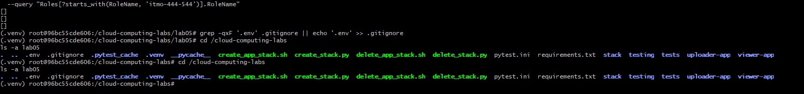
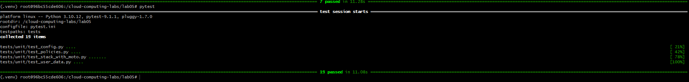
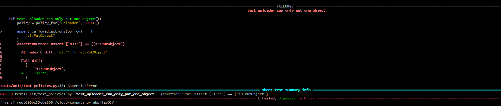
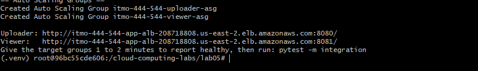
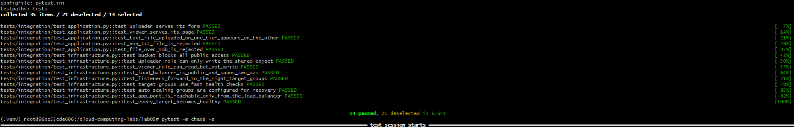
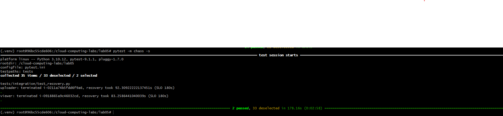
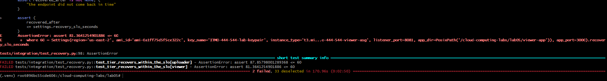
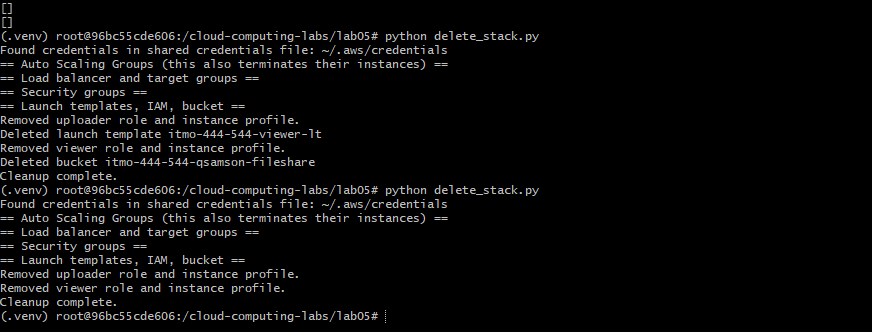

```markdown
# Lab 05 — Infrastructure as Python with boto3 and pytest

## Overview

In this lab, the previous AWS Bash infrastructure was rewritten in Python using boto3. The project creates and manages the S3 bucket, IAM roles, launch templates, security groups, target groups, Application Load Balancer, listeners, and Auto Scaling Groups.

Pytest was used for unit, integration, and chaos testing.

---

## Project Layout

The project contains:

- `stack/` — Python infrastructure modules
- `tests/unit/` — unit tests
- `tests/integration/` — integration and chaos tests
- `uploader-app/` — uploader application
- `viewer-app/` — viewer application
- `create_stack.py` — creates the AWS stack
- `delete_stack.py` — removes the AWS stack
- `pytest.ini` — pytest configuration
- `requirements.txt` — Python dependencies

### Evidence



---

## Unit Tests

The complete unit-test suite successfully passed all 19 tests.



### Break-It Experiment

The uploader IAM policy was intentionally changed from:

`s3:PutObject`

to:

`s3:*`

The least-privilege test correctly detected the change and failed. The policy was then restored to `s3:PutObject`.



---

## AWS Stack Deployment

The Python stack was deployed successfully using:

`python create_stack.py`

Both the uploader and viewer endpoints were created through the Application Load Balancer.



---

## Integration Tests

The deployed AWS infrastructure and applications were tested against the real AWS environment.

All 14 integration tests passed.



---

## Chaos and Recovery Testing

The recovery SLO was initially configured as 180 seconds.

The measured recovery times were:

- Uploader: approximately 92.31 seconds
- Viewer: approximately 83.26 seconds

Both tiers recovered within the required 180-second SLO.



### Tightened SLO Experiment

The recovery SLO was temporarily changed from 180 seconds to 60 seconds.

The measured recovery times were:

- Uploader: approximately 87.86 seconds
- Viewer: approximately 81.36 seconds

Both tests failed as expected because their recovery times exceeded the 60-second SLO. The SLO was then restored to 180 seconds.



---

## Cleanup

The AWS stack was removed using:

`python delete_stack.py`

The cleanup command was run a second time to verify that cleanup was safe to repeat.

Final AWS checks confirmed that the lab load balancer, Auto Scaling Groups, and IAM roles were removed.



---

## What Moto Proved and Its Limitations

Moto proved that my Python code could create, configure, and delete AWS resources correctly in a simulated AWS environment. It also helped verify that the create process was repeatable and that cleanup could be run more than once.

However, Moto could not prove that real EC2 instances would boot correctly, that the applications would respond over HTTP, or that IAM permissions would behave exactly the same in real AWS.

The integration and chaos tests covered these gaps by testing the deployed AWS infrastructure, application behavior, IAM permissions, target health, and recovery after an instance failure.

---

## `ignore_errors("EntityAlreadyExists")` vs. `2>/dev/null || true`

`ignore_errors("EntityAlreadyExists")` ignores only the specific AWS error that is expected and allows other unexpected errors to be raised.

In comparison, `2>/dev/null || true` can hide every error, including permission problems, incorrect commands, or other failures.

The Python approach therefore provides better error handling because expected errors can be ignored without hiding real problems.

---

## Challenge 5 — Reflection

The Bash version was shorter when handling AWS commands that might fail because it could simply use commands such as `2>/dev/null || true`.

The Python version required more lines, but those extra lines provided clearer error handling, better testing, and more control over which failures should be ignored and which should stop the program.
```
